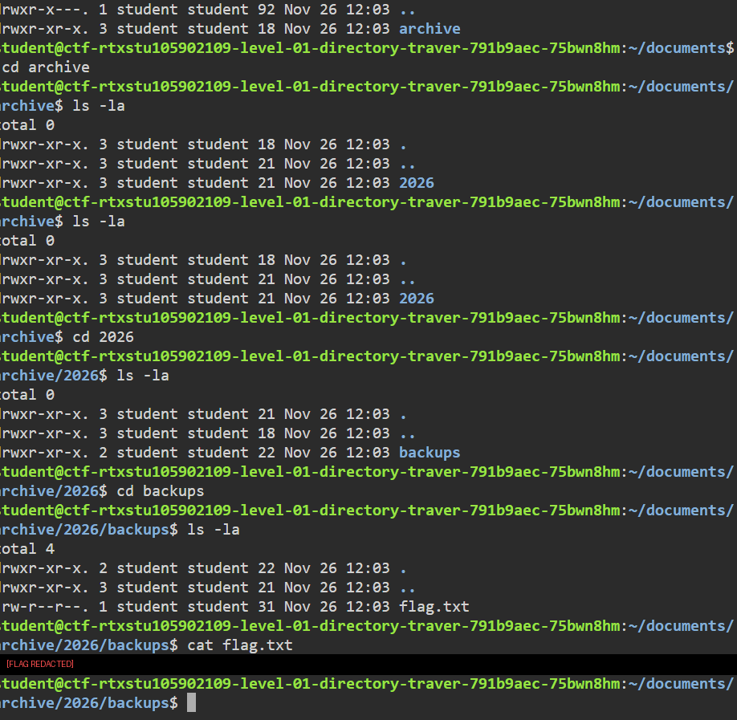

# Linux Basic — Level 01: Directory Traversal

- **Platform:** RedTeamXperience (CICSA V4.INE LITE course)
- **Module:** Part 1: Threats and Vulnerability Management
- **Difficulty / Points:** Easy / 50 pts
- **Date solved:** 2026-11-26
- **Flag:** `CTF{REDACTED}`

## Objective
Navigate the directory tree using only `cd`, `ls` and `cat` to find and read `flag.txt`.

## Access
Connect the VPN profile, then **Open lab** to get a browser shell as user `student`, starting in the home directory (`~`).

## Commands and their purpose

| Command | Purpose |
|---|---|
| `ls -la` | **Look**: list everything in the current folder, including hidden files (`.` names) |
| `cd <folder>` | **Move**: go into a directory (lines starting with `d` in `ls -la`) |
| `cd ..` | Move up one level |
| `cat <file>` | **Read**: print a file's contents (files only; on a folder it says "Is a directory") |
| `pwd` | Show the full path of where you are |

## Walkthrough

1. **Home (`~`)**: `ls -la` showed `.bashrc`, `.profile`, `README.txt` and the directory `documents`.
2. `cat README.txt` gave the hint: use `cd`, `ls` and `cat` to find the flag hidden in the folders.
3. `cd documents` → `ls -la` showed the directory `archive`.
4. `cd archive` → `ls -la` showed the directory `2026`.
5. `cd 2026` → `ls -la` showed the directory `backups`.
6. `cd backups` → `ls -la` showed `flag.txt` (a file: its line starts with `-`).
7. `cat flag.txt` printed the flag.

Path: `~/documents/archive/2026/backups/flag.txt`

```
~ (home)
└── documents
    └── archive
        └── 2026
            └── backups
                └── flag.txt
```

### Evidence


## Mistakes made (and lessons)
- **Typing the `< >` placeholder brackets.** `cd <folder>` means replace the whole placeholder with the name, e.g. `cd documents`. In bash, `<` and `>` redirect input/output.
- **Typing a filename on its own** (`README.txt`) makes bash try to *run* it ("command not found"). Use `cat README.txt`.
- **`cd` into a file** (`cd .profile`) gives "Not a directory". Only `cd` into lines starting with `d`.
- **`cat` on a folder** (`cat archive`) gives "Is a directory".
- **`cd ..` then looking for a subfolder.** `cd ..` goes back up, so `archive` was no longer in the current folder. Always check the prompt (`:~/documents$`) before typing.
- `.` (this folder) and `..` (parent folder) appear in every listing; ignore them when looking for the next step.
- A successful `cd` prints nothing; only the prompt changes.

## Takeaways
Directory traversal is a loop: **`ls` (look) → `cd` (move) → repeat → `cat` (read)**. The prompt always shows where you are.
