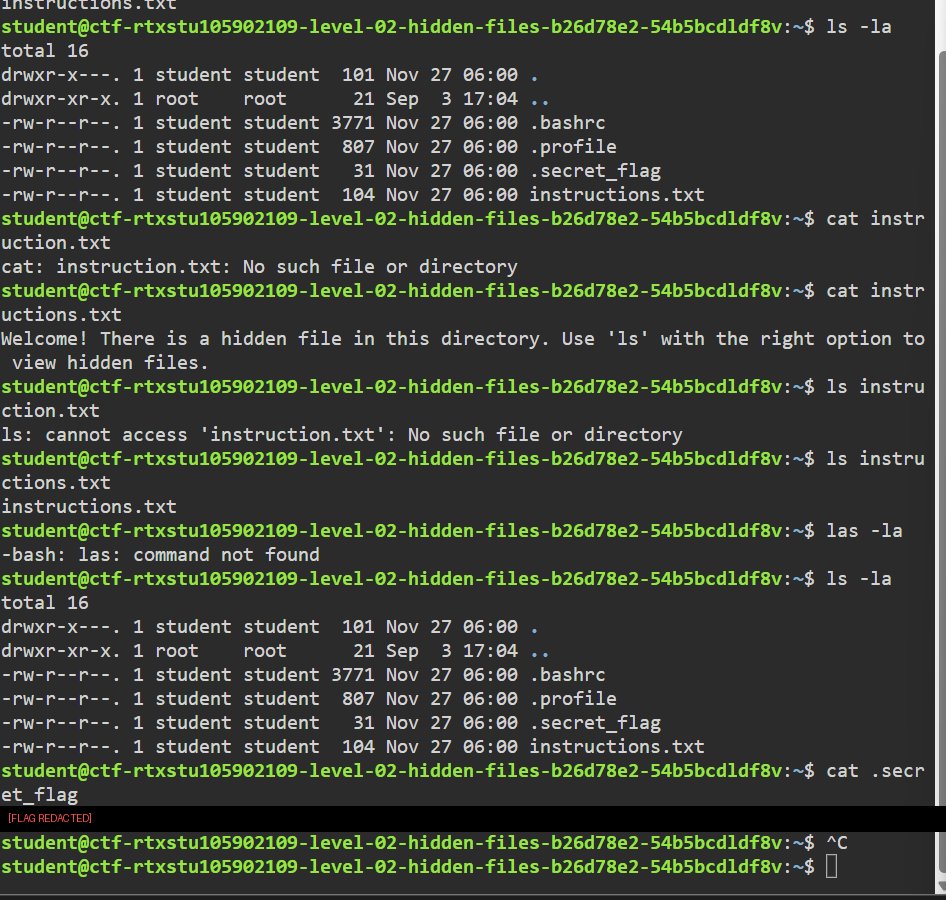

# Linux Basic — Level 02: Hidden Files

- **Platform:** RedTeamXperience (CICSA V4.INE LITE course)
- **Module:** Part 1: Threats and Vulnerability Management
- **Difficulty / Points:** Easy / 50 pts
- **Date solved:** 2026-11-27
- **Flag:** `CTF{REDACTED}`

## Objective
Files whose names start with a dot (`.`) are hidden from a regular `ls`. Find the hidden file in the student's home directory and view its content.

## Commands and their purpose

| Command | Purpose |
|---|---|
| `cd ~` | Go to the home directory, where the exercise says the file is |
| `cat instructions.txt` | Read the welcome/hint file (a normal, visible file) |
| `ls` | Normal listing: hidden (dot) files are **not** shown |
| `ls -la` | `-a` = all: shows hidden files too; `-l` = detailed list |
| `cat .secret_flag` | Read the hidden file; the leading dot is part of the name |

## Walkthrough
1. In `~`, `cat instructions.txt` printed the hint: *"There is a hidden file in this directory. Use 'ls' with the right option to view hidden files."*
2. `ls` showed only `instructions.txt`, so the hidden file was missing.
3. `ls -la` revealed **`.secret_flag`** (31 bytes) in addition to `.`, `..`, `.bashrc` and `.profile`.
4. `cat .secret_flag` printed the flag.

Path: `~/.secret_flag`

### Evidence

## Mistakes made (and lessons)
- **Typos:** `instruction.txt` (missing `s`) gave "No such file or directory", and `las -la` gave "command not found". Linux names must match exactly; use **Tab** to auto-complete.
- `ls instructions.txt` only confirms that one file exists. To see everything in a folder, run `ls -la` with no filename.
- Hidden files need `-a`; plain `ls` never shows them.
- Always keep the leading dot when using the name: `cat .secret`, not `cat secret`.

## Takeaways
Hidden files are just files whose names begin with `.`. They are commonly used for config (`.bashrc`, `.ssh/`) and are a classic place to stash things. Always check with `ls -la` in CTFs and real investigations.
