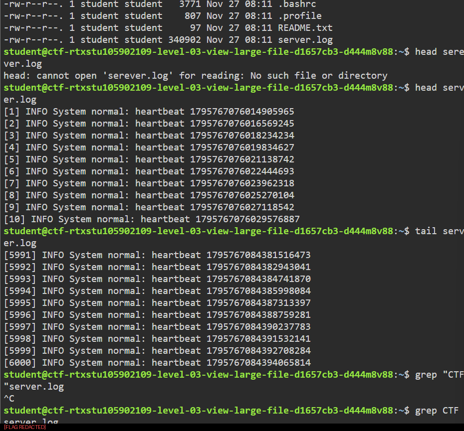

# Linux Basic — Level 03: View Large File Contents

- **Platform:** RedTeamXperience (CICSA V4.INE LITE course)
- **Module:** Part 1: Threats and Vulnerability Management
- **Difficulty / Points:** Easy / 50 pts
- **Date solved:** 2026-11-27
- **Flag:** `CTF{REDACTED}`

## Objective
A flag is buried inside `server.log`, which has thousands of log entries. Use `less`, `grep`, `head` or `tail` to extract it.

## Commands and their purpose

| Command | Purpose |
|---|---|
| `ls -la` | Confirm `server.log` exists and check its size |
| `wc -l server.log` | Count lines, to show why `cat` would flood the screen |
| `head server.log` | First 10 lines: see what a normal log entry looks like |
| `tail server.log` | Last 10 lines: check the end of the file |
| `less server.log` | Page through (Space = next page, `/text` = search, `q` = quit) |
| `grep "CTF" server.log` | Print only the lines containing `CTF`, i.e. the flag line |

## Walkthrough
1. `ls -la` showed `README.txt` and `server.log` (340,902 bytes).
2. `head server.log` showed lines `[1]`–`[10]`, all `INFO System normal: heartbeat <number>`.
3. `tail server.log` showed lines `[5991]`–`[6000]`, also normal heartbeats, so there are 6,000 lines and the flag is not at the start or end.
4. The flag format is known from the submit box: `CTF{...}`.
5. `grep CTF server.log` searched all 6,000 lines and printed only the one with the flag.

### Evidence


## Mistakes made (and lessons)
- **Typo:** `head serever.log` gave "No such file or directory". Use Tab to complete filenames.
- **Missing space:** `grep "CTF"server.log` joined the pattern and filename into one argument (`CTFserver.log`). With no file given, grep sat waiting for keyboard input, so the screen hung until Ctrl+C. Always put a space between the pattern and the file.

## Key concept: grep syntax
```
grep  "pattern"  file
grep  "CTF"      server.log
```
The pattern (what to find) comes first, then the file to search. `-i` ignores case (`grep -i ctf server.log`).

## Takeaways
Don't read huge files by hand: **search them**. Use `grep` for a known string, `head`/`tail` for the start or end, and `less` to browse. This is exactly how SOC analysts hunt through logs (e.g. `grep "Failed password" /var/log/auth.log`).
