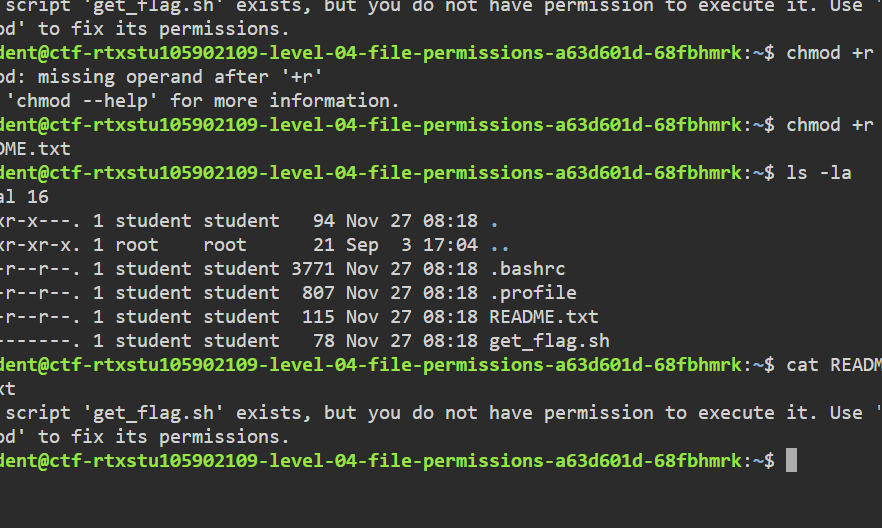
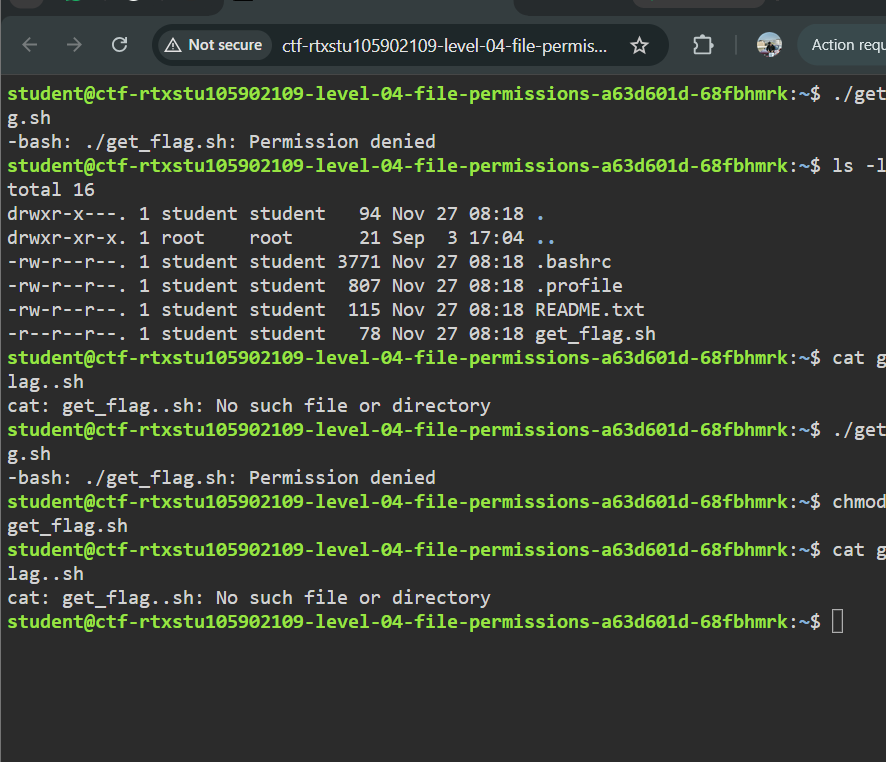

# Linux Basic — Level 04: File Permissions (chmod)

- **Platform:** RedTeamXperience (CICSA V4.INE LITE course)
- **Module:** Part 1: Threats and Vulnerability Management
- **Difficulty / Points:** Easy / 50 pts
- **Date solved:** 2026-11-27
- **Flag:** `CTF{REDACTED}`

## Objective
A script, `get_flag.sh`, prints the flag, but you don't have permission to execute it. Use `chmod` to fix its permissions and run it.

## Key concept: reading permissions
```
-rwxr-xr--
│└┬┘└┬┘└┬┘
│ │  │  └── others
│ │  └───── group
│ └──────── owner (u)
└────────── type: - file, d directory
```
`r` = read, `w` = write, `x` = execute, `-` = missing.

## Commands and their purpose

| Command | Purpose |
|---|---|
| `ls -la` | Show the permission column for each file |
| `cat README.txt` | Read the hint |
| `chmod u+rx get_flag.sh` | Give the owner (`u`) read + execute; a shell script needs **both** |
| `./get_flag.sh` | Run the script in the current folder |

## Walkthrough
1. `ls -la` showed `get_flag.sh` (78 bytes) with permissions `----------`: no read, write or execute for anyone.
2. `cat README.txt` gave the hint: *"The script 'get_flag.sh' exists, but you do not have permission to execute it. Use 'chmod' to fix its permissions."*
3. `chmod u+rx get_flag.sh` added read and execute for the owner (`student` owns the file, so it is allowed).
4. `./get_flag.sh` ran the script and printed the flag.

### Evidence




This second screenshot shows the in-between state: after adding only **read** (`-r--r--r--`), running `./get_flag.sh` still fails with **Permission denied**, because the **execute** bit (`x`) is missing. Adding `x` as well fixed it.

## Mistakes made (and lessons)
- **Typo:** `cat get_flag..sh` (two dots) gave "No such file or directory". Use Tab to auto-complete.
- `chmod +r` with no filename gave "missing operand". chmod needs a mode **and** a file: `chmod +r file`.
- `chmod +r README.txt` changed the wrong file; README was already readable. Check which file has the problem first (the `ls -la` permission column).
- `chmod +x` alone isn't enough for a script: without `r`, bash can't read the script's contents.

## Takeaways
- The owner of a file can always change its permissions with `chmod`.
- Symbolic mode: `u`/`g`/`o`/`a` + `+`/`-` + `r`/`w`/`x`. Numeric mode: r=4, w=2, x=1 (e.g. `chmod 700 file` = `rwx------`).
- Security angle: overly permissive files (e.g. world-writable scripts run by root) are a classic privilege-escalation path. Auditors look for these with `find / -perm -o+w -type f 2>/dev/null`.
