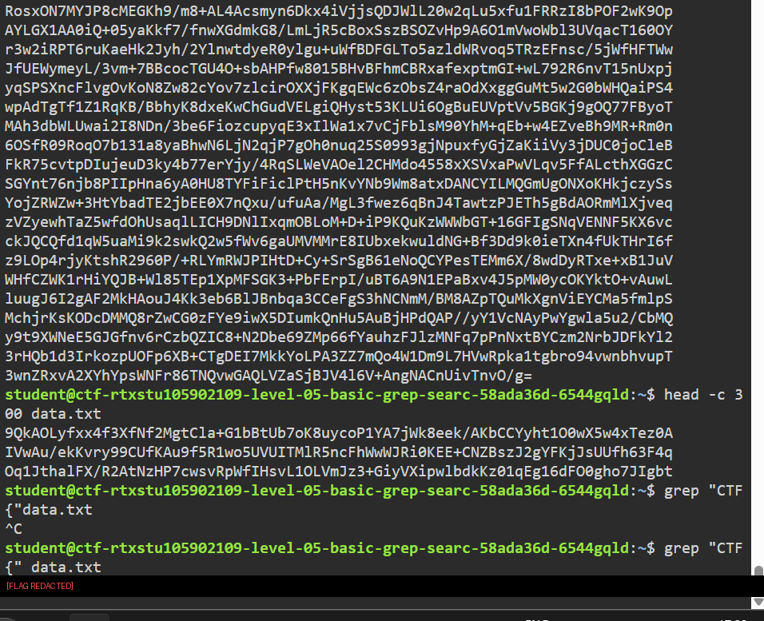

# Linux Basic — Level 05: Basic Grep Search

- **Platform:** RedTeamXperience (CICSA V4.INE LITE course)
- **Module:** Part 1: Threats and Vulnerability Management
- **Difficulty / Points:** Easy / 50 pts
- **Date solved:** 2026-11-27
- **Flag:** `CTF{REDACTED}`

## Objective
A 10 MB text file `data.txt` contains random noise and one secret line containing the flag. Use `grep` to extract it.

## Access note
The lab host (`*.challenges.pentestgarage.com`) resolves to a private `172.31.x.x` address and only loads with the RedTeamXperience VPN profile (the course `.ovpn` file) connected in OpenVPN GUI. With the VPN down, the page just times out. Disconnect other VPNs (e.g. Surfshark) during labs.

## Commands and their purpose

| Command | Purpose |
|---|---|
| `ls -la` | Confirm `data.txt` exists and check its size (~10 MB) |
| `head -c 300 data.txt` | Peek at the first 300 characters without flooding the screen |
| `grep "CTF{" data.txt` | Print only the line containing `CTF{`; the `{` avoids random "CTF" matches in the noise |
| `grep -o "CTF{[^}]*}" data.txt` | (Optional) `-o` prints only the matched flag text, not the whole line |

## Walkthrough
1. `head -c 300 data.txt` showed the noise: long lines of base64-like random characters.
2. `grep "CTF{" data.txt` found the one secret line: `USER_SECRET_FLAG=CTF{REDACTED}`.

### Evidence

## Mistakes made (and lessons)
- **Missing space again:** `grep "CTF{"data.txt` made grep treat `CTF{data.txt` as the pattern with no file, so it waited for keyboard input (cursor hangs). Fixed with **Ctrl+C**, then `grep "CTF{" data.txt`.
- Rule: `grep␣PATTERN␣FILE`, with spaces separating command, pattern and file.

## Takeaways
- Make the pattern as specific as you can (`CTF{` beats `CTF`) to avoid false positives in noisy data.
- A command that "hangs" with a blinking cursor is often waiting for input on stdin. Press Ctrl+C and check the arguments.
- SOC relevance: grepping huge logs for an exact indicator (IP, hash, username) is a core triage skill.
