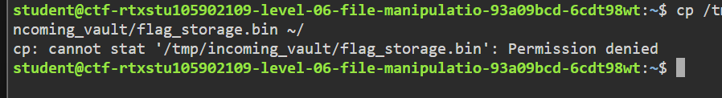
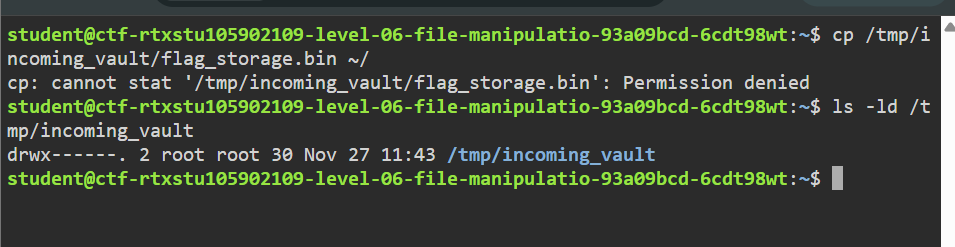
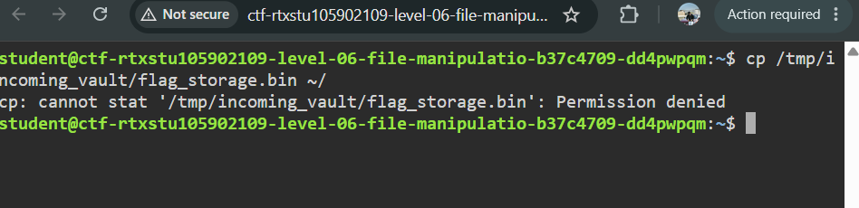

# Linux Basic — Level 06: File Manipulation (cp / mv)

- **Platform:** RedTeamXperience (CICSA V4.INE LITE course)
- **Module:** Part 1: Threats and Vulnerability Management
- **Difficulty / Points:** Easy / 50 pts
- **Status:** ⛔ BLOCKED — lab appears misconfigured; reported 2026-11-27

## Objective
A file is located at `/tmp/incoming_vault/flag_storage.bin`. Copy or move it into your home folder and view its content.

## Intended solution
```bash
cp /tmp/incoming_vault/flag_storage.bin ~/   # copy (original stays)
# or: mv /tmp/incoming_vault/flag_storage.bin ~/   # move (original removed)
cat ~/flag_storage.bin                        # or: strings ~/flag_storage.bin if it's binary
```

## What actually happened
| Command | Result |
|---|---|
| `ls -la /tmp/incoming_vault/` | `Permission denied` |
| `cp /tmp/incoming_vault/flag_storage.bin ~/` | `cannot stat ... Permission denied` |
| `ls -ld /tmp/incoming_vault` | `drwx------. 2 root root 30 Nov 27 11:43 /tmp/incoming_vault` |
| `sudo -l` | asks for a password (none provided) |

The vault directory is owned by **root** with mode **700**, so user `student` cannot list (`r`) or traverse (`x`) it. Without sudo, no `cp`/`mv` can reach the file. For a cp/mv exercise the directory should be at least `drwxr-xr-x` (755).

## Lessons learned anyway
- **Directory permissions:** `r` = list contents, `x` = enter or access files by name. Without `x` you can't even reach a file whose name you know (`cannot stat`).
- `ls -ld <dir>` shows the directory's own permissions instead of its contents.
- Only the owner (or root) can `chmod` a file or directory.
- When you hit a wall, gather facts (owner, mode, sudo rights) before guessing.

## Evidence



**After restarting the lab:** a fresh machine (hostname changed from `...93a09bcd-6cdt98wt` to `...b37c4709-dd4pwpqm`) gave the same `cp: cannot stat ... Permission denied`, so the misconfiguration is in the lab image itself, not a one-off.



## Next
Restart the lab. If it's unchanged, use ⚑ Report an issue and return once it's fixed.
