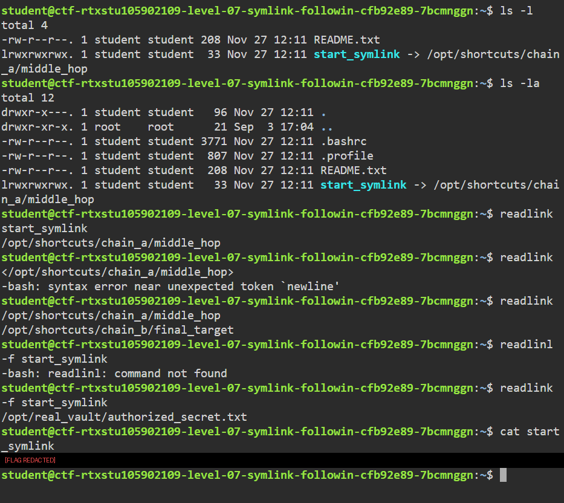

# Linux Basic — Level 07: Symlink Following

- **Platform:** RedTeamXperience (CICSA V4.INE LITE course)
- **Module:** Part 1: Threats and Vulnerability Management
- **Difficulty / Points:** Easy / 50 pts
- **Date solved:** 2026-11-27
- **Flag:** `CTF{REDACTED}`

## Objective
There is a symbolic link chain starting in the home folder. Follow the symlinks using `readlink`, `ls -l` or `cat` to retrieve the secret flag. (The overview said `step1_link`; on the machine the link was named `start_symlink`.)

## Key concept: symbolic links
A symlink is a pointer (like a Windows shortcut) to another path. In `ls -l` it starts with `l` and shows an arrow:
```
lrwxrwxrwx. 1 student student 33 ... start_symlink -> /opt/shortcuts/chain_a/middle_hop
```

## Commands and their purpose

| Command | Purpose |
|---|---|
| `ls -l` / `ls -la` | Show links and their `->` targets |
| `readlink <link>` | Print where one link points (one hop) |
| `readlink -f <link>` | Follow the whole chain and print the final real file |
| `cat <link>` | Read the final file's contents (cat follows links automatically) |

## Walkthrough
1. `ls -la` showed `start_symlink -> /opt/shortcuts/chain_a/middle_hop`.
2. `readlink start_symlink` printed `/opt/shortcuts/chain_a/middle_hop` (hop 1).
3. `readlink /opt/shortcuts/chain_a/middle_hop` printed `/opt/shortcuts/chain_b/final_target` (hop 2).
4. `readlink -f start_symlink` resolved the full chain to `/opt/real_vault/authorized_secret.txt`.
5. `cat start_symlink` printed the flag.

Chain:
```
~/start_symlink
  → /opt/shortcuts/chain_a/middle_hop
    → /opt/shortcuts/chain_b/final_target
      → /opt/real_vault/authorized_secret.txt   (real file: the flag)
```

### Evidence


## Mistakes made (and lessons)
- **Placeholder brackets:** `readlink </opt/...>` gave "syntax error near unexpected token `newline'". `<` and `>` are redirection symbols in bash; never type the placeholder brackets.
- **Typo:** `readlinl` gave "command not found".

## Takeaways
- `readlink` = one hop; `readlink -f` = the final destination.
- Tools like `cat` transparently follow symlinks, so a harmless-looking link can point anywhere.
- Security angle: symlink attacks are a real privilege-escalation technique, e.g. a root process that writes to a path an attacker has replaced with a symlink to `/etc/passwd`. Always check where links really point.
