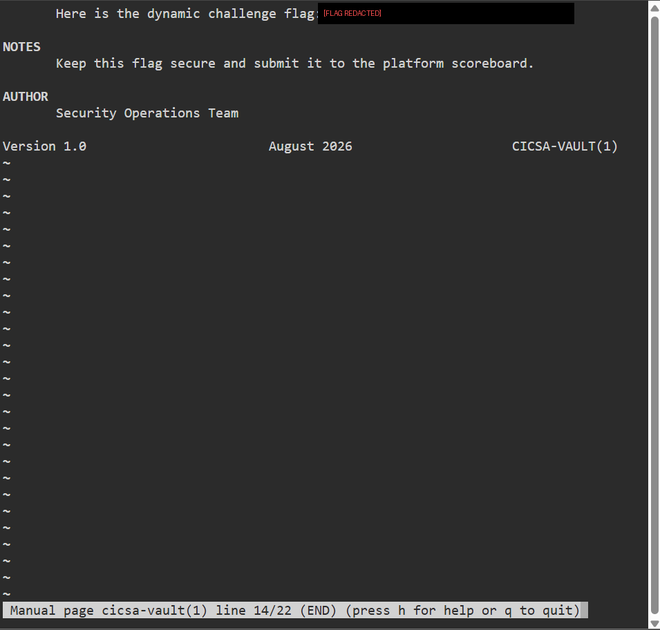

# Linux Basic — Level 08: Man Page Explorer

- **Platform:** RedTeamXperience (CICSA V4.INE LITE course)
- **Module:** Part 1: Threats and Vulnerability Management
- **Difficulty / Points:** Easy / 50 pts
- **Date solved:** 2026-11-27
- **Flag:** `CTF{REDACTED}`

## Objective
A custom security utility manual is installed. Run `man cicsa-vault` to read the documentation and find the flag in it.

## Key concept: man pages
`man <name>` opens the built-in manual in a pager (like `less`). Sections: NAME, SYNOPSIS, DESCRIPTION, NOTES, AUTHOR…

| Key | Action |
|---|---|
| Space / ↓ | Next page / line |
| b / ↑ | Previous page / line |
| `/text` + Enter | Search; `n` = next match |
| q | Quit |

## Commands and their purpose

| Command | Purpose |
|---|---|
| `man cicsa-vault` | Open the custom manual page |
| `/CTF` (inside man) | Search the page for the flag |
| `man -k cicsa` | Search manual names/descriptions if unsure of the exact name |
| `man cicsa-vault \| grep "CTF{"` | Pipe the manual text into grep to print just the flag line |

## Walkthrough
1. `man cicsa-vault` opened the manual page `CICSA-VAULT(1)`, Version 1.0, author "Security Operations Team".
2. Searching or scrolling to the end found: *"Here is the dynamic challenge flag: CTF{...}"*, followed by a NOTES section.

### Evidence

## Mistakes made (and lessons)
- `man CICSA volt` gave "No manual entry". Names are **case-sensitive** and must be exact: lowercase `cicsa`, a hyphen, and `vault` (not "volt").
- If unsure of a name, search instead of guessing: `man -k <keyword>`.

## Takeaways
- `man` is the first place to look when you don't know a command's options (e.g. `man grep`, `man chmod`).
- The `|` pipe sends one command's output into another (`man ... | grep ...`), a pattern used constantly in log analysis.
