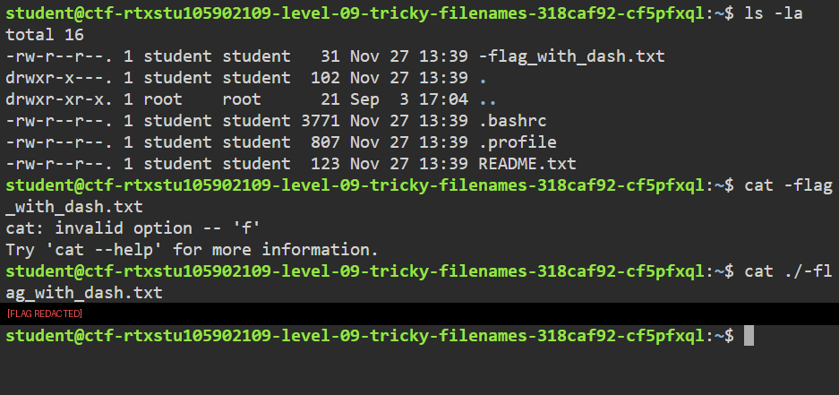

# Linux Basic — Level 09: Tricky Filenames (Dashes)

- **Platform:** RedTeamXperience (CICSA V4.INE LITE course)
- **Module:** Part 1: Threats and Vulnerability Management
- **Difficulty / Points:** Easy / 50 pts
- **Date solved:** 2026-11-27
- **Flag:** `CTF{REDACTED}`

## Objective
A file named `-flag_with_dash.txt` is in the home directory. Because the name begins with `-`, `cat -flag_with_dash.txt` is parsed as options. Find a way to read it.

## Key concept
Commands treat arguments starting with `-` as options. To pass such a name as a file:

| Method | Command | Why |
|---|---|---|
| Path prefix | `cat ./-flag_with_dash.txt` | `./` = current folder; the argument now starts with `.`, not `-` |
| End of options | `cat -- -flag_with_dash.txt` | `--` means "no more options; everything after is a filename" |

## Walkthrough
1. `ls -la` showed `-flag_with_dash.txt` (31 bytes) and `README.txt`.
2. `cat -flag_with_dash.txt` gave `cat: invalid option -- 'f'`: cat read `-f` as an option flag.
3. `cat ./-flag_with_dash.txt` printed the flag.

### Evidence

## Takeaways
- `./name` and `--` work with any command: `rm ./-file`, `mv -- -file newname`, `grep -- -pattern file`.
- Security angle: attackers sometimes plant files named like options (e.g. `--checkpoint-action=exec=sh shell.sh`) so that a careless `tar *` or `chown *` run by an admin treats them as options ("wildcard injection"). Using `./*` or `--` prevents this.
