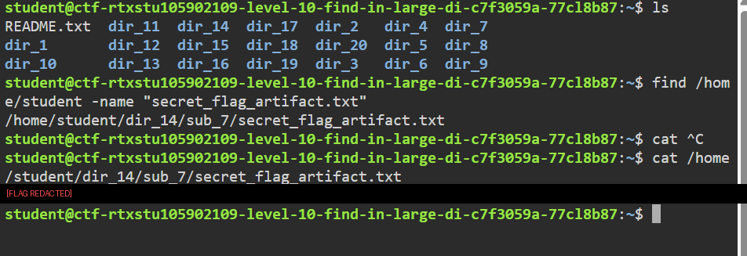

# Linux Basic — Level 10: Find in Large Directory Tree

- **Platform:** RedTeamXperience (CICSA V4.INE LITE course)
- **Module:** Part 1: Threats and Vulnerability Management
- **Difficulty / Points:** Easy / 50 pts
- **Date solved:** 2026-11-27
- **Flag:** `CTF{REDACTED}`

## Objective
There are hundreds of nested directories under `/home/student`. Use `find` to locate `secret_flag_artifact.txt` and read the flag.

## Key concept: find
```
find  <start dir>  -name  "<filename>"
```
`find` walks the start directory and **every** subdirectory below it, printing the full path of each match.

## Commands and their purpose

| Command | Purpose |
|---|---|
| `ls` | Showed `README.txt` and 20 folders, `dir_1` … `dir_20`, each with more subfolders inside |
| `find /home/student -name "secret_flag_artifact.txt"` | Search the whole tree by exact name |
| `cat /home/student/dir_14/sub_7/secret_flag_artifact.txt` | Read the file at the path find printed |
| `find /home/student -name "..." -exec cat {} \;` | (Alternative) find and cat in one command |
| `find /home/student -iname "*secret_flag*"` | (Fallback) case-insensitive, wildcard search |

## Walkthrough
1. `ls` showed 20 top-level folders (`dir_1`–`dir_20`). Browsing them by hand would take ages.
2. `find /home/student -name "secret_flag_artifact.txt"` returned `/home/student/dir_14/sub_7/secret_flag_artifact.txt`.
3. `cat` on that path printed the flag.

### Evidence


## Takeaways
- Use `find` when you know (part of) a name but not where it is. Use `grep` when you know the content.
- Useful filters: `-type f` (files only), `-iname` (ignore case), `-size +1M`, `-mtime -1` (changed in the last day), `-perm -4000` (SUID files).
- Security angle: `find / -perm -4000 -type f 2>/dev/null` is a standard privilege-escalation recon command, and `find / -mmin -10` helps incident responders see what changed recently.
