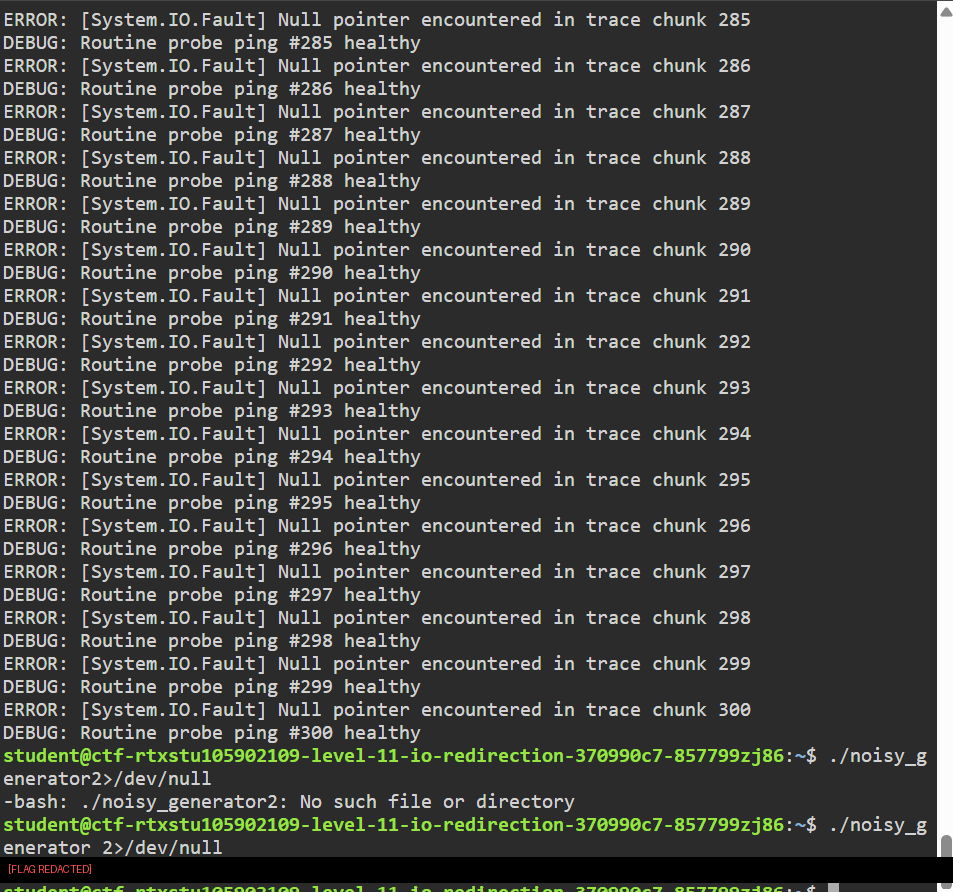

# Linux Beginner — Level 11: I/O Redirection

- **Platform:** RedTeamXperience (CICSA V4.INE LITE course)
- **Module:** Part 1: Threats and Vulnerability Management
- **Difficulty / Points:** Easy / 100 pts
- **Date solved:** 2026-11-28
- **Flag:** `CTF{REDACTED}`

## Objective
Run `./noisy_generator`. It writes hundreds of error lines to stderr and normal lines to stdout. The real flag is printed to stdout and only becomes visible once stderr is discarded with `2>/dev/null`.

## Key concept: stdout vs stderr

| Stream | FD | Contents |
|---|---|---|
| stdin | 0 | input |
| stdout | 1 | normal output |
| stderr | 2 | errors and warnings |

| Redirection | Effect |
|---|---|
| `2>/dev/null` | discard stderr (`/dev/null` deletes whatever is written to it) |
| `> out.txt` / `1> out.txt` | stdout to a file |
| `2> err.txt` | stderr to a file |
| `2>&1` | merge stderr into stdout |
| `cmd \| grep x` | pipe stdout (only) into another command |

## Walkthrough
1. `./noisy_generator` flooded the screen with 300 pairs of `ERROR: [System.IO.Fault] Null pointer encountered in trace chunk N` and `DEBUG: Routine probe ping #N healthy`.
2. `./noisy_generator2>/dev/null` (no space) gave `No such file or directory`, because bash read `noisy_generator2` as the program name.
3. `./noisy_generator 2>/dev/null` discarded stderr and printed only the flag.

### Evidence

## Mistakes made (and lessons)
- **Missing space before `2>`:** `./noisy_generator2>/dev/null` glued the `2` onto the program name. The rule is: space **before** `2>`, no space **between** `2` and `>`: `./noisy_generator 2>/dev/null`.

## Takeaways
- Errors and normal output are separate streams that just look mixed on screen; redirection lets you split them.
- `2>/dev/null` is the standard way to silence noise, e.g. `find / -name x 2>/dev/null`.
- SOC relevance: separating stdout/stderr (and `2>&1` into log files) is how scripts and cron jobs capture clean results and keep error logs for troubleshooting.
