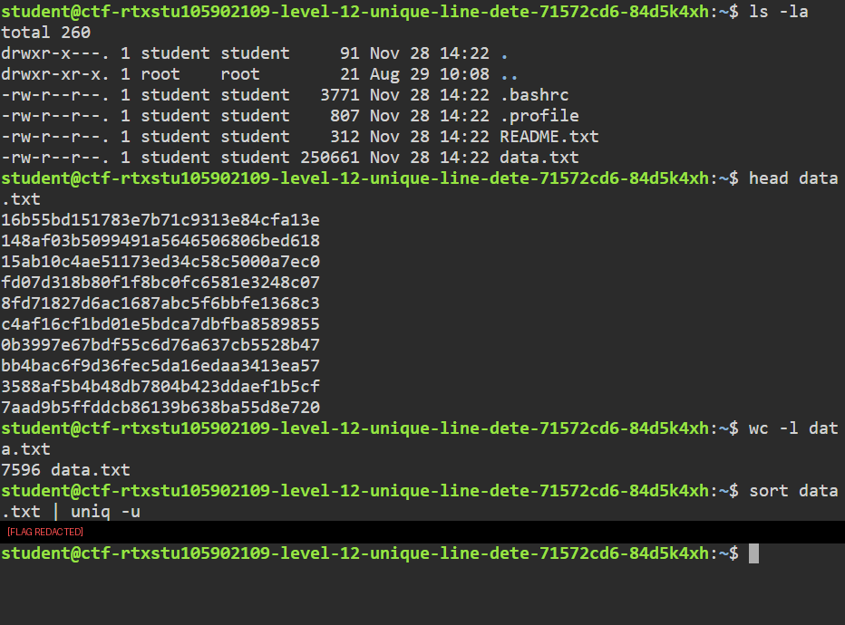
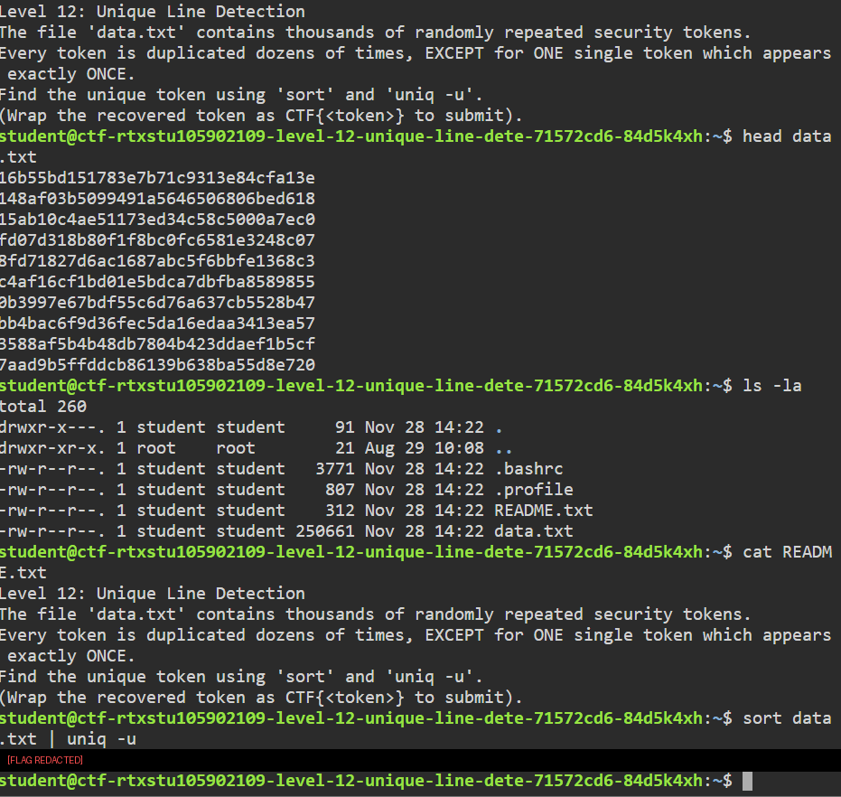

# Linux Beginner — Level 12: Unique Line Detection

- **Platform:** RedTeamXperience (CICSA V4.INE LITE course)
- **Module:** Part 1: Threats and Vulnerability Management
- **Difficulty / Points:** Easy / 100 pts
- **Date solved:** 2026-11-28
- **Unique token:** `REDACTED`
- **Flag:** `CTF{REDACTED}`

## Objective
`data.txt` contains thousands of repeated security tokens. Every token is duplicated dozens of times except one, which appears exactly once. Use `sort` and `uniq` to extract it.

## Key concept

| Command | Purpose |
|---|---|
| `sort` | Order lines so identical ones become adjacent |
| `uniq` | Collapse **adjacent** duplicates (so it needs sorted input) |
| `uniq -u` | Print only lines that occur exactly once |
| `uniq -d` | Print only lines that occur more than once |
| `uniq -c` | Prefix each line with its count |

## Walkthrough
1. `ls -la` showed `README.txt` and `data.txt` (250,661 bytes).
2. `head data.txt` showed 32-character hex tokens (e.g. `16b55bd151783e7b71c9313e84cfa13e`).
3. `wc -l data.txt` showed 7,596 lines.
4. `sort data.txt | uniq -u` printed one line: `REDACTED`. It's not hex like the others, so it is clearly the planted flag token.

### Evidence

## Takeaways
- `sort | uniq -u` = items seen once; `sort | uniq -c | sort -n` = frequency table (rarest first).
- SOC relevance: frequency analysis ("stack counting") is a core hunting technique. Rare process names, user agents or destination IPs (`sort | uniq -c | sort -n | head`) often reveal the anomaly hidden among thousands of normal events.
