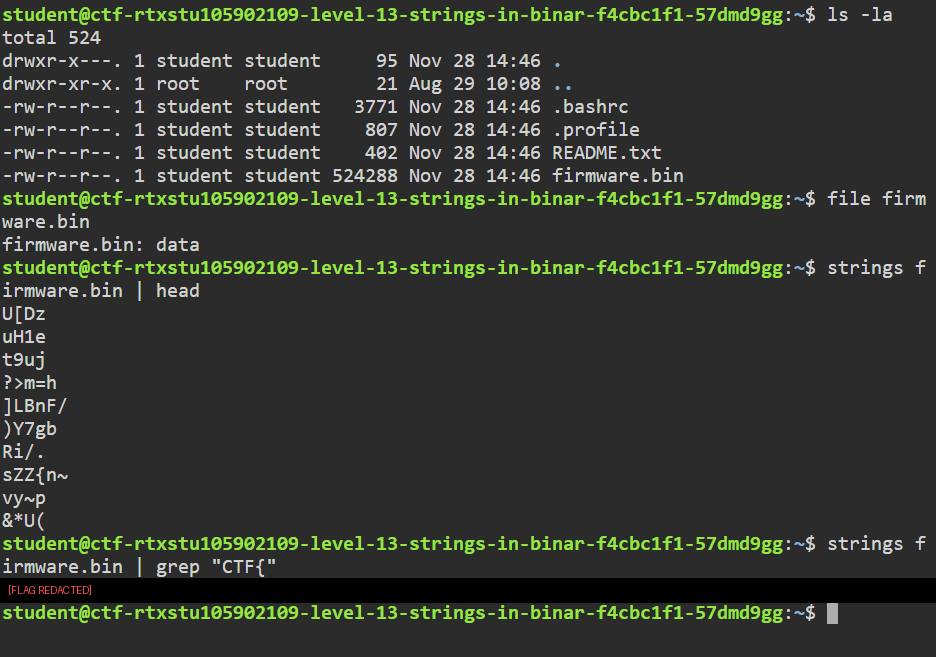

# Linux Beginner — Level 13: Strings in Binary Blobs

- **Platform:** RedTeamXperience (CICSA V4.INE LITE course)
- **Module:** Part 1: Threats and Vulnerability Management
- **Difficulty / Points:** Easy / 100 pts
- **Date solved:** 2026-11-28
- **Flag:** `CTF{REDACTED}`

## Objective
`firmware.bin` is a raw binary image full of non-printable bytes. Use `strings` to locate the human-readable flag inside.

## Key concept
- `cat` on a binary prints garbage (and can scramble the terminal; fix with `reset`).
- `strings <file>` prints only runs of 4+ printable characters; `-n N` sets the minimum length.
- `file <file>` identifies the file type from its content, not its extension.

## Commands and their purpose

| Command | Purpose |
|---|---|
| `ls -la` | `firmware.bin` = 524,288 bytes (512 KB) |
| `file firmware.bin` | `data`: no known format, raw binary |
| `strings firmware.bin \| head` | First readable runs: short random junk (`U[Dz`, `uH1e`, `t9uj`…) |
| `strings firmware.bin \| grep "CTF{"` | Extract readable text, then keep only the flag line |

## Walkthrough
1. `file firmware.bin` → `data`, confirming a binary blob.
2. `strings firmware.bin | head` showed that random bytes also produce meaningless short "strings", so filtering is needed.
3. `strings firmware.bin | grep "CTF{"` returned the flag.

### Evidence

## Takeaways
- Pipeline pattern: **produce** (`strings`) → `|` → **filter** (`grep`).
- `grep` directly on a binary often just says "binary file matches"; `strings` first makes it readable.
- Security angle: `strings` is a first-pass static-analysis tool for malware and firmware, revealing embedded URLs, IPs, credentials, commands and C2 domains (e.g. `strings sample.exe | grep -Ei "http|\.exe|password"`).
